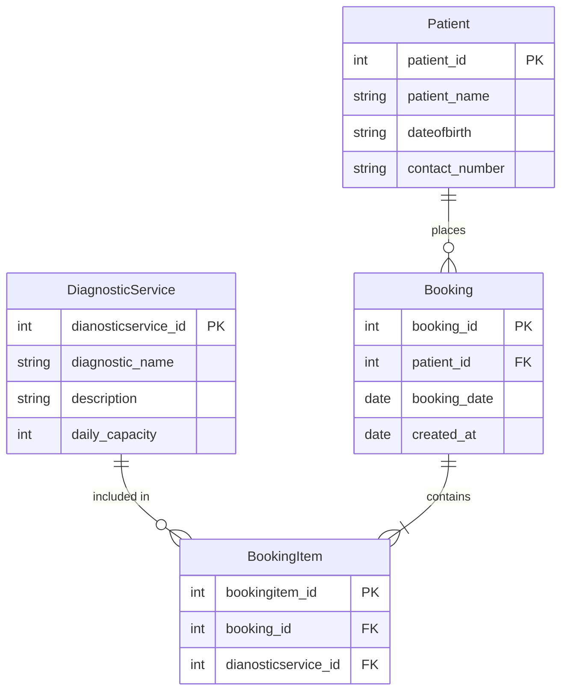

# CareFlow - Diagnostic Booking Management
**Course Component**: ITSD81 - Desktop Application Development  
**Unit**: IV - Data-Driven Application Architecture and Transactional Workflows  
**Deliverable**: Performance Task 4 (Pair Activity)  

---

## 1. Project Overview & Architecture

**CareFlow** is an outpatient diagnostic booking management desktop application developed using **C#**, **.NET 10**, **Avalonia UI (XAML + MVVM)**, and **Entity Framework Core (SQLite)**.

The system ensures strict transaction management and data consistency:
- When patients request multiple diagnostic services for a specific date, every requested service must be available.
- If even one requested service has reached its daily capacity, or if an unexpected database failure occurs, the **entire booking request is aborted and rolled back** (atomicity). No partial records are ever persisted.

### Architectural Separation of Concerns
The solution maintains strict boundaries between UI, application logic, and persistence:
- **`Views/`**: Avalonia XAML desktop views (`MainWindow.axaml`). Purely handles layout and data bindings; does not interact directly with the database.
- **`ViewModels/`**: MVVM ViewModels (`MainViewModel.cs`, `SelectableServiceViewModel.cs`) powered by CommunityToolkit.Mvvm. Manages UI state, observable collections, and asynchronous commands.
- **`Services/`**: Business logic layer (`BookingService.cs`, `IBookingService.cs`). Encapsulates all 10 mandatory business rules (BR-01 through BR-10) and transaction boundaries.
- **`Data/`**: Entity Framework Core persistence (`CareFlowDbContext.cs`, `CareFlowDbContextFactory.cs`). Manages table configurations, relational constraints, and seed data.
- **`Models/`**: Domain entities (`Patient.cs`, `DiagnosticService.cs`, `Booking.cs`, `BookingItem.cs`).

---

## 2. Relational Design

*(UNIQUE INDEX on BookingItem: `BookingId`, `DiagnosticServiceId`)*

### Entity Tables Summary

#### 1. Patient Table
| Column | Data Type | Constraints | Description |
|---|---|---|---|
| `Id` | INTEGER | Primary Key, Auto-increment | Unique identifier for patient |
| `FullName` | TEXT | Required, Max length 150 | Patient's complete name |
| `DateOfBirth` | TEXT | Optional | Patient's date of birth |
| `ContactNumber`| TEXT | Max length 50 | Contact phone number |

#### 2. DiagnosticService Table
| Column | Data Type | Constraints | Description |
|---|---|---|---|
| `Id` | INTEGER | Primary Key, Auto-increment | Unique service ID |
| `Name` | TEXT | Required, Max length 100 | Service name (e.g. CBC, ECG) |
| `Description` | TEXT | Optional | Description of the test |
| `DailyCapacity`| INTEGER | Required | Maximum bookings allowed per day |

#### 3. Booking Table
| Column | Data Type | Constraints | Description |
|---|---|---|---|
| `Id` | INTEGER | Primary Key, Auto-increment | Booking reference number |
| `PatientId` | INTEGER | Foreign Key -> `Patient(Id)` | References existing patient (BR-01) |
| `BookingDate` | TEXT | Required, Indexed | Scheduled date of diagnostic tests |
| `CreatedAt` | TEXT | Required | Audit timestamp |

#### 4. BookingItem Table (Junction Table)
| Column | Data Type | Constraints | Description |
|---|---|---|---|
| `Id` | INTEGER | Primary Key, Auto-increment | Item line identifier |
| `BookingId` | INTEGER | Foreign Key -> `Booking(Id)` | Parent booking header |
| `DiagnosticServiceId` | INTEGER | Foreign Key -> `DiagnosticService(Id)` | Selected test (BR-02, BR-04) |
| *(Composite)* | UNIQUE INDEX | `(BookingId, DiagnosticServiceId)` | Prevents duplicate service (BR-06) |

## 4. Mandatory Business Rules Implementation Matrix

| Rule ID | Rule Requirement | Implementation Location | Verification |
|---|---|---|---|
| **BR-01** | Booking must reference an existing patient. | `BookingService.cs` (`patientExists` check) | UI Combobox binds strictly to seeded patients; invalid IDs are rejected. |
| **BR-02** | Booking must contain 1 to 3 distinct services. | `BookingService.cs` (`ServiceIds.Count` check) | Validated in UI and Service; blocks requests with 0 or >3 services. |
| **BR-03** | Date cannot be earlier than current local date. | `BookingService.cs` (`request.BookingDate < today`) | Past dates return validation error. |
| **BR-04** | Each service consumes 1 unit of daily capacity. | `BookingService.cs` (`GetAvailabilityAsync`) | Live query counts existing `BookingItem` records per date. |
| **BR-05** | Confirmed bookings cannot exceed daily capacity. | `BookingService.cs` (Pre-commit transaction check) | If booked count reaches `DailyCapacity`, submission is blocked. |
| **BR-06** | Same service cannot appear twice in one request. | `BookingService.cs` & `CareFlowDbContext.cs` | LINQ `.Distinct()` check and Unique composite index on DB. |
| **BR-07** | Atomicity: all changes committed together or none. | `BookingService.cs` (`BeginTransactionAsync()`) | Entire transaction rolls back on any error; no partial inserts. |
| **BR-08** | Availability rechecked at confirmation. | `BookingService.cs` (Inside transaction block) | Re-queries current counts immediately before inserting. |
| **BR-09** | Information persists between app executions. | SQLite Database (`careflow.db`) | Data reloads on startup. |
| **BR-10** | Clear feedback for invalid requests or failures. | `MainViewModel.cs` & `StatusMessage` UI banner | Color-coded status notifications for errors and confirmations. |

---

## 5. Verification Checklist (Acceptance Scenarios)

| Scenario ID | Scenario Description | How Checked / Tested | Expected Result | Status |
|---|---|---|---|---|
| **AC-01** | View diagnostic services for a selected date | Selected date in DatePicker; verified capacity numbers against seeded values. | Remaining spots correctly calculate as: `DailyCapacity - BookedCount`. | **Verified** |
| **AC-02** | Create a booking containing multiple available services | Selected patient, chose date, checked CBC and Urinalysis, clicked Confirm. | One confirmed booking created with ID #1 containing both services. | **Verified** |
| **AC-03** | Request a fully booked service or submit invalid data | Attempted to submit with 0 services selected, and with a past date. | Both rejected with descriptive error messages; 0 database rows created. | **Verified** |
| **AC-04** | Attempt a booking after previously displayed capacity becomes unavailable | Booked ECG twice (capacity = 2). On third booking, requested ECG + CBC. | Entire booking rejected because ECG reached capacity. CBC was not booked. | **Verified** |
| **AC-05** | A required database operation fails before booking is committed | Checked *"Simulate Database Crash Before Commit (AC-05)"* checkbox and clicked Confirm. | Exception thrown before commit; transaction rolled back; no orphaned records. | **Verified** |
| **AC-06** | Close and restart application after confirming booking | Confirmed bookings, terminated the application, and relaunched with F5. | Previously recorded bookings and associated services reloaded from SQLite. | **Verified** |

---
